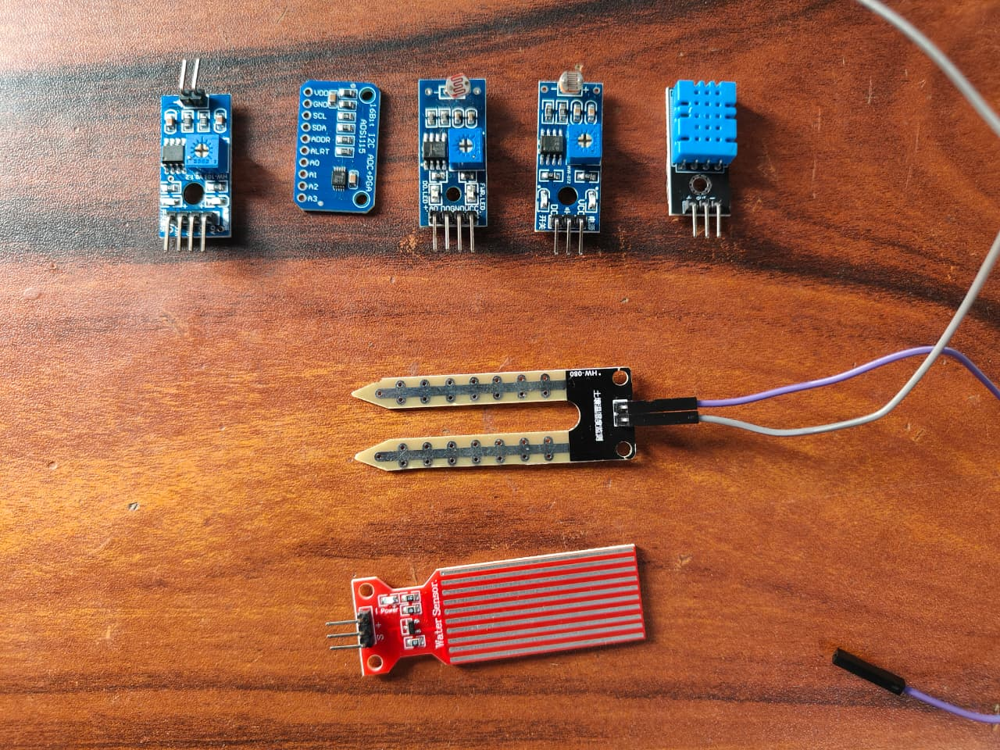
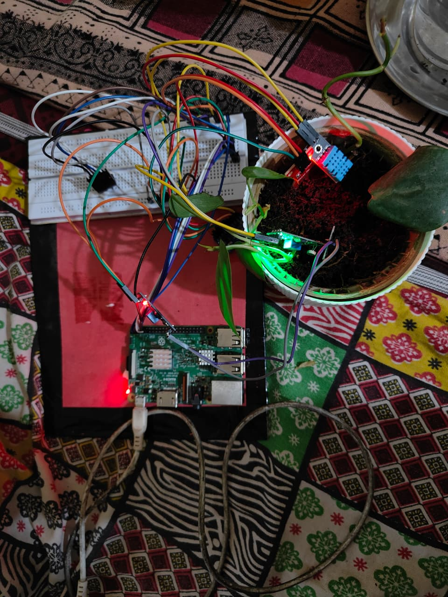

# FloraAI Hardware Wiring & Pinout Guide

This guide details how to wire all sensors and actuators to the **Raspberry Pi 3 Model B**.

---

## 1. Key Concept: The Shared I2C Bus

Notice that **ADS1115**, **BME280**, and **BH1750** are all **I2C devices**.
In I2C communication, multiple sensors connect to the **EXACT SAME TWO PINS** on the Raspberry Pi:
- **SDA** (Data): Physical Pin 3 (`GPIO 2`)
- **SCL** (Clock): Physical Pin 5 (`GPIO 3`)

Each sensor has a unique digital address on the wire, so the Raspberry Pi talks to each one without any collision:
| Sensor | Default I2C Address | Function |
| :--- | :--- | :--- |
| **ADS1115** | `0x48` | 16-bit Analog-to-Digital Converter (for soil moisture) |
| **BME280** | `0x76` (or `0x77`) | Ambient Temp, Relative Humidity, Pressure |
| **BH1750** | `0x23` (or `0x5C`) | Ambient Light Intensity (Lux) |

---

## 2. Master Wiring Table

### A. I2C Sensors Connection (Use a breadboard or terminal block to distribute 3.3V, GND, SDA, SCL)

| Sensor Pin | Connects To | Raspberry Pi 3B Physical Pin | Note |
| :--- | :--- | :--- | :--- |
| **ADS1115 VDD** | 3.3V Power | **Pin 1** (3.3V PWR) | Never connect to 5V if Pi GPIO is 3.3V |
| **ADS1115 GND** | Ground | **Pin 6** (GND) | Shared ground |
| **ADS1115 SCL** | I2C Clock | **Pin 5** (GPIO 3 / SCL) | Shared I2C SCL line |
| **ADS1115 SDA** | I2C Data | **Pin 3** (GPIO 2 / SDA) | Shared I2C SDA line |
| **ADS1115 ADDR**| Ground | **Pin 9** (GND) | Sets address to `0x48` |
| | | | |
| **BME280 VCC** | 3.3V Power | **Pin 1** (3.3V PWR) | Shared with 3.3V rail |
| **BME280 GND** | Ground | **Pin 6** (GND) | Shared with GND rail |
| **BME280 SCL** | I2C Clock | **Pin 5** (GPIO 3 / SCL) | Shared I2C SCL line |
| **BME280 SDA** | I2C Data | **Pin 3** (GPIO 2 / SDA) | Shared I2C SDA line |
| | | | |
| **BH1750 VCC** | 3.3V Power | **Pin 1** (3.3V PWR) | Shared with 3.3V rail |
| **BH1750 GND** | Ground | **Pin 6** (GND) | Shared with GND rail |
| **BH1750 SCL** | I2C Clock | **Pin 5** (GPIO 3 / SCL) | Shared I2C SCL line |
| **BH1750 SDA** | I2C Data | **Pin 3** (GPIO 2 / SDA) | Shared I2C SDA line |
| **BH1750 ADDR**| Ground | **Pin 9** (GND) | Sets address to `0x23` |

---

### B. Capacitive Soil Moisture Sensor (Analog Input)

The Raspberry Pi has no analog input pins. That is why we connect the capacitive sensor to the **ADS1115 ADC**:

| Capacitive Sensor Pin | Connects To | Notes |
| :--- | :--- | :--- |
| **VCC** | 3.3V Power Rail | Power with 3.3V so output voltage stays within safe ADC bounds |
| **GND** | Ground Rail | Shared Ground |
| **AOUT (Signal)** | **ADS1115 Pin A0** | Analog voltage read by ADS1115 channel 0 |

---

### C. 5V Relay Module & Water Pump (Actuator)

> [!WARNING]
> **ELECTRICAL SAFETY:**
> Never power a motor directly from a Raspberry Pi GPIO pin! A GPIO pin can only safely supply ~16mA at 3.3V. A pump draws 200mA - 1000mA (1A). Attempting to power a pump directly will fry your Raspberry Pi.
> Always use a Relay Module (or MOSFET module) to switch external or 5V power to the pump.

#### Relay Module Control Pins:
| Relay Pin | Connects To | Raspberry Pi Pin |
| :--- | :--- | :--- |
| **VCC** | 5V Power | **Pin 2** or **Pin 4** (5V PWR) |
| **GND** | Ground | **Pin 14** (GND) |
| **IN / SIG** | Control Signal | **Pin 11** (`GPIO 17`) |

#### Pump Power Circuit (Relay Output Terminal):
- **External 5V Power Supply (+)** or Pi Pin 2 -> Connect to Relay **COM** (Common) terminal.
- Relay **NO** (Normally Open) terminal -> Connect to **Pump Red Wire (+)**.
- **Pump Black Wire (-)** -> Connect to **Power Supply (-)** / GND.

When `GPIO 17` triggers the relay, the mechanical switch closes between COM and NO, completing the circuit and powering the pump!

---

## 3. Quick Raspberry Pi 40-Pin Header Cheat Sheet

```
                   3.3V PWR [ 1] [ 2] 5V PWR (Relay VCC)
 (Shared SDA) GPIO 2 / SDA [ 3] [ 4] 5V PWR
 (Shared SCL) GPIO 3 / SCL [ 5] [ 6] GND (Shared Ground)
               GPIO 4 / GPCLK [ 7] [ 8] GPIO 14 / TXD
                          GND [ 9] [10] GPIO 15 / RXD
    (Relay IN)    GPIO 17 [11] [12] GPIO 18
                  GPIO 27 [13] [14] GND
                  GPIO 22 [15] [16] GPIO 23
                 3.3V PWR [17] [18] GPIO 24
               GPIO 10 / MOSI [19] [20] GND
                GPIO 9 / MISO [21] [22] GPIO 25
               GPIO 11 / SCLK [23] [24] GPIO 8 / CE0
                          GND [25] [26] GPIO 7 / CE1
...
```

---

## 📸 Physical Hardware Setup Proof

Below is the verified hardware setup running on Raspberry Pi 3 Model B, showing the ADS1115 ADC converter, sensor modules, and breadboard rails:

| Hardware Overview | Circuit & Sensor Connections |
| :---: | :---: |
|  |  |
| *Raspberry Pi 3 Model B IoT telemetry setup* | *Sensor wiring, I2C bus lines & ADC channel routing* |

---

## 4. Soil Sensor Calibration Steps

Capacitive sensors measure the dielectric permittivity of the soil. Before placing it permanently:
1. **Dry Air Reading**: Hold the sensor in the air. Run `python test_hardware.py`.
   - Record the raw ADC value (typically around `22,000` to `23,000`).
2. **Wet Reading**: Dip the sensor blade into a cup of water up to the white line (do not submerge the electronics at the top!).
   - Record the raw ADC value (typically around `10,500` to `12,000`).
3. Update `SOIL_DRY_ADC` and `SOIL_WET_ADC` in `config.py` with your recorded values.
