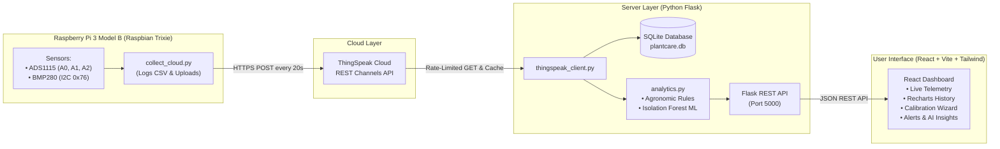

# 🌿 PlantCare AI — AI-Powered IoT Plant Monitoring & Smart Agriculture Platform

PlantCare AI is a full-stack smart agriculture and IoT plant monitoring platform designed for real-world environmental telemetry. It connects physical sensors attached to a **Raspberry Pi 3 Model B**, securely uploads data to **ThingSpeak Cloud**, retrieves and validates telemetry through a **Python Flask backend**, and renders a **React + Tailwind CSS** dashboard featuring explainable agronomic heuristics, interactive time-series analytics, and **Scikit-Learn Machine Learning (Isolation Forest)** anomaly detection.

---

## 📑 Table of Contents

1. [System Architecture & Data Flow](#1-system-architecture--data-flow)
2. [Hardware Connections (Raspberry Pi)](#2-hardware-connections-raspberry-pi)
3. [ThingSpeak Cloud Setup & Field Mapping](#3-thingspeak-cloud-setup--field-mapping)
4. [Quick Start: Running on Your Laptop (Dev & Demo)](#4-quick-start-running-on-your-laptop)
5. [Running the Collector on Raspberry Pi](#5-running-the-collector-on-raspberry-pi)
6. [Soil Sensor Calibration Workflow](#6-soil-sensor-calibration-workflow)
7. [Machine Learning Anomaly Detection](#7-machine-learning-anomaly-detection)
8. [Backend REST API Reference](#8-backend-rest-api-reference)
9. [Troubleshooting Guide](#9-troubleshooting-guide)
10. [Production Deployment Guide](#10-production-deployment-guide)

---

## 1. System Architecture & Data Flow



### Key Principles:
* **Separation of Concerns:** The Raspberry Pi hardware collector, the Flask cloud backend, and the React dashboard are modular.
* **Advisory Mode Only:** The water pump is **not connected** (no motor driver module). The platform provides watering recommendations only—no automatic pump activation is implemented or simulated.
* **Transparency:** Live cloud readings, cached historical data, and demo simulation mode are explicitly distinguished. The dashboard never silently fabricates mock data when cloud access fails.

---

## 2. Hardware Connections (Raspberry Pi)

All analog sensors connect to the **ADS1115 16-bit ADC** over I²C (`0x48`). The **BMP280** digital sensor connects over I²C (`0x76`).

| Sensor | Connected Channel / Pins | Address | Measurement & Role |
| :--- | :--- | :--- | :--- |
| **Analog Soil Moisture Sensor** | ADS1115 Pin **A2** | `0x48` | Soil substrate voltage (V). Calibrated to relative % in software. |
| **Analog Ambient Light Sensor** | ADS1115 Pin **A1** (AO output) | `0x48` | Photoperiod intensity voltage (V). |
| **Water / Rain-Style Sensor** | ADS1115 Pin **A0** (S output) | `0x48` | Surface trace moisture signal (V). *Not a tank-level measurement.* |
| **ADS1115 Pin A3** | Unused / Reserved | `0x48` | Open for future expansion. |
| **BMP280 Sensor** | I2C SDA (Pin 3), SCL (Pin 5) | `0x76` | Ambient Temperature (°C) and Barometric Pressure (hPa). |
| **Water Pump** | **NOT CONNECTED** | — | Disabled. Never connect a pump directly to GPIO pins without a driver. |

> ⚠️ **Important BMP280 Note:** The BMP280 measures temperature and barometric pressure. Unlike the BME280, it does **not** measure humidity. PlantCare AI does not fabricate humidity readings.

---

## 3. ThingSpeak Cloud Setup & Field Mapping

1. Log into your free account at [ThingSpeak.com](https://thingspeak.mathworks.com/).
2. Create a Channel (or use your existing channel) and configure the fields:
   * **Field 1:** `Soil Voltage`
   * **Field 2:** `Light Voltage`
   * **Field 3:** `Temperature C`
   * **Field 4:** `Pressure hPa`
   * **Field 5:** `Water Sensor Voltage`
3. Locate your credentials:
   * **Channel ID:** Found on the channel header or *Channel Settings* tab.
   * **Write API Key:** Used by the Raspberry Pi collector to upload readings.
   * **Read API Key:** Used by the Flask backend to fetch readings if your channel is private.
4. **Rate Limit:** ThingSpeak's free tier requires at least **15 seconds** between channel updates. The collector uploads every ~20 seconds, and the backend caches queries for 20 seconds to prevent rate-limit penalties.

---

## 4. Quick Start: Running on Your Laptop

### A. Prerequisites
* **Python 3.10+** (Python 3.13 / 3.14 recommended)
* **Node.js v18+** & **npm**

### B. Configure Environment Variables
Inside the `plantcare-ai/` directory:
```bash
# Copy example configuration to .env
cp .env.example .env
```
Open `.env` in an editor:
```env
PORT=5000
FLASK_DEBUG=True

# Enter your ThingSpeak credentials:
THINGSPEAK_CHANNEL_ID=YOUR_CHANNEL_ID
THINGSPEAK_READ_API_KEY=YOUR_READ_API_KEY

# Polling cache time (seconds)
THINGSPEAK_CACHE_TTL_SECONDS=20

# Demo Mode: Set to 'true' if testing offline without real cloud keys yet
DEMO_MODE=true
```

### C. Backend Setup & Startup
In a terminal on your laptop:
```bash
# Navigate to the backend directory
cd plantcare-ai/backend

# Install Python dependencies
pip install -r requirements.txt

# Run the backend test suite to verify everything is working
python -m unittest tests/test_backend.py

# Start the Flask API server
python app.py
```
The Flask backend will start on `http://localhost:5000`.

### D. Frontend Setup & Startup
In a second terminal:
```bash
# Navigate to frontend directory
cd plantcare-ai/frontend

# Install Node dependencies
npm install

# Start the Vite development server
npm run dev
```
Open your browser at:
👉 **`http://localhost:5173`**

*(Note: If you run `npm run build` in the frontend, the Flask backend at `http://localhost:5000` will serve the built production application directly!)*

---

## 5. Running the Collector on Raspberry Pi

Run these commands directly in a terminal on your **Raspberry Pi 3 Model B**:

```bash
# 1. Navigate to your collector directory on Pi
cd ~/plant-monitor

# 2. Activate your virtual environment
source .venv/bin/activate

# 3. Ensure hardware dependencies are installed
pip install adafruit-circuitpython-ads1x15 adafruit-circuitpython-bmp280 requests

# 4. Configure ThingSpeak credentials
cp pi_collector/cloud_config.example.py cloud_config.py
nano cloud_config.py
# (Enter your THINGSPEAK_CHANNEL_ID and THINGSPEAK_WRITE_API_KEY, then save)

# 5. Run the collector
python collect_cloud.py
```

The collector reads sensors every 5 seconds, appends rows to `plant_data_all.csv`, and uploads to ThingSpeak every 20 seconds.

To enable the collector as an automatic background systemd service:
```bash
sudo cp pi_collector/plantcare-collector.service /etc/systemd/system/
sudo systemctl daemon-reload
sudo systemctl enable plantcare-collector.service
sudo systemctl start plantcare-collector.service
```

---

## 6. Soil Sensor Calibration Workflow

Because soil composition and capacitive sensors differ, raw voltage cannot be accurately displayed as a percentage without reference points:

1. In the PlantCare AI dashboard, navigate to the **Plant Health & AI** tab.
2. Scroll to the **Soil Moisture Sensor Calibration Wizard**.
3. **Dry Reference:**
   * Remove the sensor from the soil (or insert it in bone-dry soil).
   * Note the live voltage (typically `2.4V – 2.9V`).
   * Click **"Set as Dry Voltage"**.
4. **Wet Reference:**
   * Place the sensor into thoroughly watered, saturated soil.
   * Note the live voltage (typically `1.0V – 1.4V`).
   * Click **"Set as Wet Voltage"**.
5. **Polarity:** Standard capacitive sensors output *higher voltage when dry* (select *Inverted*).
6. Click **"Save Calibration to Database"**.
7. The dashboard will now calculate calibrated relative soil moisture ($0\% - 100\%$) across all cards and alerts.

---

## 7. Machine Learning Anomaly Detection

PlantCare AI incorporates an unsupervised **Isolation Forest** (`scikit-learn`) model that detects unusual multi-sensor excursions.

### Feature Vector:
$$\vec{x} = [\text{soil\_voltage\_v}, \text{light\_voltage\_v}, \text{temperature\_c}, \text{pressure\_hpa}, \text{water\_voltage\_v}]$$

### Training the Model:
Once you have collected at least 50 readings in `data/plant_data_all.csv` (or use the included `data/plant_data_sample.csv`):
```bash
python ml/train_anomaly_model.py
```
This script cleans the dataset, fits the `IsolationForest(n_estimators=100, contamination=0.05)`, and outputs:
* `ml/anomaly_model.pkl`: Serialized model.
* `ml/model_metadata.json`: Feature statistics, versioning, and baseline distributions.

### Evaluating Model Diagnostics:
```bash
python ml/evaluate_model.py
```
Tests sample vectors (nominal afternoon, heat spike, sensor disconnection) and displays explainable feature deviations.

---

## 8. Backend REST API Reference

| Method | Endpoint | Description |
| :--- | :--- | :--- |
| `GET` | `/api/health` | Backend status, cloud configured flag, demo mode status. |
| `GET` | `/api/sensors/latest` | Latest entry, data freshness (seconds ago, staleness flag), parsed sensor values. |
| `GET` | `/api/sensors/history?range=24h` | Historical readings (`1h`, `24h`, `7d`, `all`) with rate-limit protection. |
| `GET` | `/api/analytics/summary` | 24-hour summary statistics (min, max, average, latest, trend arrow). |
| `GET` | `/api/analytics/plant-status` | Rule-based agronomic evaluation (`Normal`, `Needs Attention`, `Critical`), diagnosis, and recommendations. |
| `GET` | `/api/analytics/anomalies` | Machine Learning Isolation Forest evaluation on current telemetry. |
| `GET` | `/api/alerts?unresolved=true` | List recorded environmental and hardware alerts. |
| `POST` | `/api/alerts/<id>/resolve` | Mark an alert as resolved. |
| `GET` | `/api/settings` | Non-secret settings and calibration parameters. |
| `PUT` | `/api/settings` | Validate and update settings (temperature limits, calibration, refresh intervals). |
| `GET` | `/api/export/csv?range=24h` | Download historical telemetry as a CSV file attachment. |
| `POST` | `/api/demo/toggle` | Toggle demo simulation mode on/off. |
| `GET` | `/api/status/cloud` | Diagnostic connection report for ThingSpeak REST API. |

---

## 9. Troubleshooting Guide

### 1. ThingSpeak HTTP 404
* **Cause:** Incorrect Channel ID in `.env`.
* **Fix:** Log into ThingSpeak, verify your Channel ID number, and update `.env`.

### 2. ThingSpeak HTTP 403 / 400
* **Cause:** Missing or invalid Read API Key for a private channel.
* **Fix:** In ThingSpeak, go to *API Keys* -> *Read API Key*, copy it into `.env`, and restart Flask.

### 3. Stale Telemetry Notice
* **Cause:** No readings uploaded to ThingSpeak in > 120 seconds.
* **Fix:** Ensure the Raspberry Pi collector is running (`sudo systemctl status plantcare-collector.service`) and check Pi internet connectivity.

### 4. Raw ADC Voltages Close to 0.0V or 3.3V
* **Near 0.0V:** Check if the sensor ground or signal jumper wire has slipped out of the ADS1115 terminal.
* **Near 3.3V:** Check if the sensor VCC or analog pin is pulled up or open-circuit.

### 5. I2C Sensors Not Detected on Raspberry Pi
* Run `i2cdetect -y 1`. You should see `48` (ADS1115) and `76` (BMP280). If missing, re-verify 3.3V and GND breadboard rails.

---

## 10. Production Deployment Guide

### Deploying the Backend (e.g. Render, Railway, or VPS)
1. Set the root directory to `plantcare-ai/backend`.
2. Set build command: `pip install -r requirements.txt`.
3. Set start command: `gunicorn app:app -b 0.0.0.0:$PORT` (or `python app.py`).
4. In your hosting provider's dashboard, configure environment variables:
   * `THINGSPEAK_CHANNEL_ID`
   * `THINGSPEAK_READ_API_KEY`
   * `THINGSPEAK_CACHE_TTL_SECONDS=20`
   * `DEMO_MODE=false`
   * `CORS_ORIGIN=https://your-frontend-domain.com`

### Deploying the Frontend (e.g. Vercel, Netlify)
1. Set root directory to `plantcare-ai/frontend`.
2. Build command: `npm run build`.
3. Publish directory: `dist`.
4. If frontend and backend are hosted on different domains, configure the backend URL in `frontend/src/services/api.js` (or proxy rewrite in `vercel.json` / `_redirects`).

---

## 🔒 Security Best Practices
* **Never commit `.env` or `cloud_config.py`** containing real API keys.
* **Never enter API keys into frontend code.** The React UI communicates exclusively with your backend, protecting your private Read API Key.
* **Use HTTPS** when deploying online.
